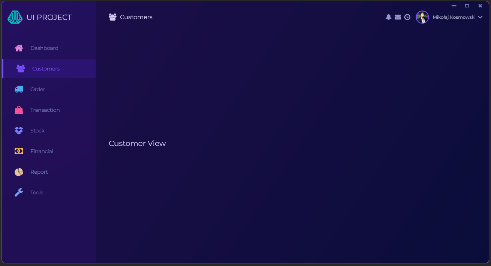

# Modern UI Tutorial

> A modern desktop dashboard application built with WPF and the MVVM pattern.


## Table of Contents

- [Overview](#overview)
- [Features](#features)
- [Technology Stack](#technology-stack)
- [Application Preview](#application-preview)
- [Project Structure](#project-structure)
- [Database Setup](#database-setup)
- [Getting Started](#getting-started)
- [Tutorial Context](#tutorial-context)

## Overview

**Modern UI Tutorial** is a desktop dashboard application developed with Windows Presentation Foundation (WPF) and .NET Framework 4.8. The project demonstrates how to combine a modern user interface with the MVVM architectural pattern, command-based navigation, custom XAML styling, and database-backed user authentication.

The application starts with a login screen. After successful authentication, the user is taken to the main dashboard, which provides a sidebar navigation menu and a dynamic content area for individual views.

## Features

- Modern, custom-styled WPF interface.
- Login screen with username and password binding.
- User authentication against a MySQL/MariaDB database.
- Password input implemented with a bindable custom control.
- MVVM-based view and command management.
- Dashboard layout with a sidebar navigation menu.
- Dynamic switching between dashboard and customer views.
- Display of the authenticated user's account information.
- Custom window chrome with minimize, maximize, and close controls.
- FontAwesome icons, gradients, custom colors, and Montserrat typography.

## Technology Stack

| Category | Technology |
|---|---|
| Language | C# |
| Desktop framework | WPF |
| Target framework | .NET Framework 4.8 |
| Application architecture | MVVM |
| Data access | MySql.Data |
| Database | MySQL / MariaDB |
| UI markup | XAML |
| Icons | FontAwesome.WPF |
| Dependency management | NuGet via `packages.config` |

## Application Preview

### Login screen


### Main dashboard



## Project Structure

```text
ModernUITutorial/
├── Assets/                    # README screenshots
├── DBDumps/                   # SQL database dump
├── ModernUITutorial/
│   ├── CustomControls/        # Reusable custom WPF controls
│   ├── Fonts/                 # Application fonts
│   ├── Images/                # Application images and icons
│   ├── Models/                # Application models and interfaces
│   ├── Repositiories/         # Database repositories
│   ├── Styles/                # Shared colors and control styles
│   ├── ViewModel/             # MVVM view models and commands
│   └── Views/                 # XAML views
├── ModernUITutorial.slnx      # Visual Studio solution
└── README.md
```

## Database Setup

The application uses a MySQL/MariaDB database named `mvvmlogindb`. A ready-to-import SQL dump is included in the repository:

```text
DBDumps/mvvmlogindb.sql
```

The dump creates the `users` table and includes sample user records for local development.

### Import the database

1. Start a local MySQL or MariaDB server.
2. Create a database named `mvvmlogindb`.
3. Import `DBDumps/mvvmlogindb.sql` using a database client such as phpMyAdmin, MySQL Workbench, or the MySQL command-line client.
4. Verify that the connection settings match the configuration used by `RepositoryBase`:

```text
Server=localhost;Database=mvvmlogindb;User=root;Password=;
```

### Sample credentials

The imported dump includes the following development account:

| Username | Password |
|---|---|
| `admin` | `admin` |

## Getting Started

### Prerequisites

- Windows operating system.
- Visual Studio with desktop development tools and .NET Framework 4.8 support.
- Local MySQL or MariaDB server.
- Git, if cloning the repository.

### Run the application

1. Clone or download the repository.
2. Set up the database by following the [Database Setup](#database-setup) instructions.
3. Open `ModernUITutorial.slnx` in Visual Studio.
4. Restore the NuGet packages if Visual Studio does not restore them automatically.
5. Set `ModernUITutorial` as the startup project.
6. Build and run the application with **F5**.
7. Sign in with the sample credentials or another user available in the `users` table.

## Architecture

The project follows a practical MVVM structure:

- **Views** define the visual layout in XAML.
- **ViewModels** expose bindable properties and commands used by the views.
- **Models** represent application data and repository contracts.
- **Repositories** encapsulate database access and authentication queries.
- **Styles and resources** centralize colors, control templates, and reusable UI definitions.

The application startup flow displays the login view first. Once authentication succeeds, the login window is closed and the main dashboard view is opened with the authenticated user's information loaded from the database.

## Tutorial Context

This project was created as part of a practical WPF tutorial. Its purpose is to demonstrate the fundamentals of building a polished desktop interface, applying MVVM concepts, creating reusable styles and controls, and connecting a WPF application to a relational database.
